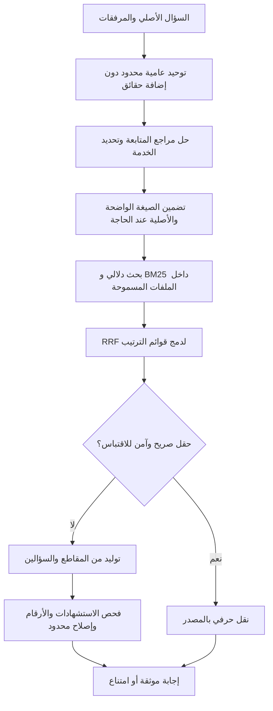

# مراجعة هندسية عكسية وإصلاح فهم اللهجات العربية — DocMind

تحديث الأداء: راجع [SPEED.md](SPEED.md) لقياسات المسار السريع وشروط الاقتباس الحرفي الآمن. نتائج 59/61 اختبارًا الواردة أدناه تاريخية؛ المجموعة الحالية بعد تحسين السرعة اجتازت 64 اختبارًا.

تاريخ المراجعة: 14 أكتوبر 2026. هذا توثيق للكود والتجارب الفعلية، وليس شهادة امتثال أو ضمان دقة مطلقة أو ضمان للفوز. البيانات الحكومية المستخدمة في الاختبار اصطناعية؛ ملف الدورة هو ملف المستخدم الموجود محليًا.

## المشكلة والسبب

المثال المبلغ عنه: **«شقد الساعات»**. ملف الدورة يذكر **20 ساعة إجمالي التدريب** و**2 ساعة مدة الجلسة اليومية**. وجود المقطع في لوحة الأدلة لا يعني أن نموذج الإجابة فهم السؤال أو اقتبس قيمته بصورة صحيحة.

تتبعنا الطلب من واجهة المحادثة إلى `answer` في `lib/rag.ts`، ثم معالجة السؤال، اختيار الملفات، التضمين، BM25 وRRF، إعداد السياق، توليد الإجابة وفحص الاستشهادات. كشفت المراجعة:

1. كان السؤال المنفصل يمر دون توضيح اللهجة. إعادة الصياغة السابقة كانت لمعالجة مراجع المحادثة أساسًا.
2. صيغة البحث المحسنة لم تكن تمرر إلى التوليد إلا في حالة محددة من أسئلة المتابعة.
3. البحث اللفظي لم يوحد الأرقام العربية وأداة التعريف بصورة متسقة.
4. المكتبة الأصلية استخدمت `nomic-embed-text`؛ وضع الحكومة استخدم `bge-m3`. لا يصح الخلط بين فهرسيهما أو افتراض أن جودة العربية متساوية.
5. التحقق العددي كان يؤثر في علامة grounded والتخزين المؤقت، لكنه لا يمنع دائمًا عرض إجابة نهائية برقم غير مدعوم.

في إعادة الإنتاج على الإعداد القديم، استرجع السؤال العامي مقاطع عن مخرجات الدورة وأطلس، وأنتج جوابًا عن مخرجات الدورة خلال 41.19 ثانية. لم تتكرر نفس عبارة الامتناع الموجودة بالصورة، لكن تكرر فشل الإجابة عن المطلوب. حفظت النتيجة دون تغيير في `dialect-before.json` محليًا.

## مسار الطلب بعد الإصلاح



### 1. فهم اللهجة دون إبطاء بطلب توليد إضافي

`lib/query-normalization.ts` يوحّد صيغًا محددة مثل شقد، شكد، قديش، اديش وكام إلى كم، وشو/شنو/وش/ايش إلى ما، وغيرها من أدوات السؤال. تصبح «شقد الساعات» **«كم عدد الساعات»**. لا يضيف «20» أو «الدورة» أو اسم خدمة إلى السؤال من عنده.

الاستبدال على مستوى كلمات Unicode، لا باستخدام `\b` غير الملائم لحدود الكلمات العربية. يحافظ على الوحدات والأسماء والقيود والنفي والأرقام. القاموس محدود؛ ليس نموذجًا يغطي كل اللهجات والأخطاء الإملائية. الاحتفاظ بالسؤال الأصلي مهم إذا لم تلائم إعادة الصياغة معنى المستخدم.

### 2. الاسترجاع متعدد الصيغ والمرفقات

`lib/retrieval.ts` يبقي BM25 مع cosine similarity، ويضيف `rankQueries` لدمج ترتيب الصيغة الأصلية والصيغة الواضحة باستخدام RRF. لا يخلط المتجهات بمتوسط حسابي ولا يخلط أبعاد نموذجين. تُرسل الصيغتان في دفعة تضمين واحدة، وتستخدم ذاكرة الاستعلامات المحلية. عند متابعة تعتمد على سجل المحادثة نستخدم السؤال المحلول لتجنب استرجاع الضمير المعزول.

التوحيد اللفظي يطوي أداة التعريف وبعض اللواصق المحدودة في BM25 فقط. لا يستخدم تجذيرًا عدوانيًا قد يخلط الأسماء أو يحذف النفي. النص الأصلي للمستند يبقى كما هو للاستشهاد. عزل الملفات المرفقة وتوجيه الخدمة يسبقان البحث؛ الصيغة الإضافية لا توسّع نطاق المرفقات.

### 3. تمرير المقصود إلى نموذج الإجابة

`lib/rag.ts` يمرر السؤال الأصلي **ومعه صيغة البحث المحلولة إذا اختلفت**. صيغة السؤال ليست دليلًا؛ الحقائق تأتي من المقاطع فقط. هذا يعالج فشل التوليد حتى عندما يكون المقطع الصحيح قد استُرجع بالفعل.

### 4. منع اعتماد أرقام غير مدعومة

بعد التوليد تُراجع الأرقام مقابل المصدر المشار إليه، وتُحاول مراجعة واحدة عند فشلها. إذا استمر الفشل، تُستبدل الإجابة بامتناع، ولا تُحفظ كإجابة موثقة. اختبارات آلية تفرض أن النموذج يصحح 4 إلى 2 عند وجود 2 فقط، وأن محاولة التصحيح إلى 9 تُرفض.

هذا فحص دعم عددي، **ليس تحققًا دلاليًا شاملًا**: وجود رقم في مقطع لا يثبت أنه مربوط بالحقل الصحيح. كذلك تصل مسودة التوليد عبر البث قبل اكتمال التحقق، وقد تُستبدل في النهاية. لا ينبغي تقديم مؤشر الثقة على أنه احتمال صحة مُعاير.

ظهر خلال التجارب رقم خاطئ جديد في مدة الجلسة. لذلك أضفنا `lib/session-evidence.ts`: نقلًا حرفيًا محدودًا لحقل «مدة الجلسة اليومية» عندما يكون السؤال مطابقًا لهذا الحقل دون قيود إضافية. يبحث عن تعارض في كامل نطاق المستندات المحدد، ولا يعتمد على أول نتيجة فقط. لا يحسب عدد الساعات، ولا يثبت قيمة 2 في الكود؛ يقرأ القيمة والوحدة من النص سواء سبقتا اسم الحقل أو تبعتاه. اختُبر على 2 ساعة و٣ ساعات و90 دقيقة، مع رفض ملفات متعددة أو نفي أو مؤهلات غير مدعومة. الحقول والصيغ غير المطابقة تعود لمسار RAG العادي.

## Tokenization والتضمينات: ماذا استخدمنا فعليًا؟

هناك ثلاث عمليات مختلفة، ولا نخلط بينها:

| العملية | التنفيذ | الحدود |
|---|---|---|
| تقسيم المقاطع | `chunkPages` وفق الفقرات والعناوين، نحو 500 رمز مقدّر وتداخل 80 | `tokenEstimate` تقدير Unicode، ليس tokenizer النموذج |
| كلمات BM25 | كلمات Unicode، توحيد تشكيل/ألف وأرقام، طي أداة التعريف | ليست جذورًا صرفية ولا تحليلًا لغويًا كاملًا |
| رموز نموذج التضمين | tokenizer الخاص بالنموذج داخل Ollama عند `/api/embed` | هو الذي يحدد رموز الإدخال الفعلية |

الإعداد الافتراضي الجديد **BGE-M3** للعربية والإنجليزية. لا نضيف له تعليمة Nomic. وإذا اختير Nomic صراحةً، تبقى بادئتا `search_query:` و`search_document:` مطبقتين وفق وثيقته. نستخدم **dense embeddings** من Ollama؛ لا ندعي تشغيل sparse embeddings أو ColBERT الخاصين بـBGE-M3. BM25 مسار منفصل داخل التطبيق، ولا يوجد cross-encoder reranker في هذه النسخة.

`truncate:false` يمنع قص نهاية النص بصمت إذا تجاوز حد النموذج. تُرفض متجهات الصفر والأبعاد المختلفة داخل الدفعة والقيم غير المحدودة والردود غير الصالحة. اختلاف إعداد التضمين يغير بصمة الفهرس ويستلزم إعادة الفهرسة؛ لا نستخدم فهرس Nomic مع استعلام BGE-M3.

قياس فعلي محفوظ في `dialect-token-audit.json`: 11 مستندًا و103 مقاطع، أكبر مقطع وفق التقدير 499 رمزًا؛ استدعاء النموذج لذلك المقطع أعاد **388 رمزًا فعليًا**، ومتجهًا بأبعاد **1024** وطول L2 يقارب **1.00000014**. هذا تدقيق لمقطع محدد، وليس إثباتًا لتطابق تقديرنا مع tokenizer في كل لغة أو ملف. حد الإدخال الفعلي يحميه النموذج مع منع القص.

## التجارب والنتائج

اجتازت مجموعة الاختبارات البرمجية **59/59** بعد الإصلاح، بما فيها اختبارات اللهجة وعقود المتجهات والمرفقات والتصحيح العددي والاقتباس الحرفي المتعارض.

نجح بناء الإنتاج النهائي، ثم نجح فحص HTTP على المنفذ 3000 بعد تفعيل الفهرس الجديد: السؤال الأصلي أعاد 20 ساعة خلال **9.625 ثانية** من طرف العميل، وسؤال الجلسة أعاد 2 ساعة خلال **0.941 ثانية**. كلاهما دون إعادة استعمال إجابة مخزنة (`cached:false`). السجل المحلي: `data/dialect-http-smoke.json`؛ إعادة الفحص: `node scripts/dialect-http-smoke.mjs` بعد تشغيل التطبيق. لا يكفي هذا الفحص العددي وحده للحكم على صحة أسئلة غير مختبرة.

| التجربة | النتيجة المسجلة |
|---|---|
| صيغ شقد، شكد، قديش، اديش، كام، والفصحى على ملف الدورة | استرجاع المقطع المطلوب ضمن أعلى 5: **8/8** |
| رسوم ووثائق وشروط ومدد واستثناءات على خدمات حكومية مختلفة | استرجاع المقطع المطلوب ضمن أعلى 5: **9/9** |
| «شقد الساعات» بعد الإصلاح النهائي | **20 ساعة** مع مرجع؛ 4.26 ثانية في آخر إعادة دافئة |
| «شقد ساعات الجلسة اليومية؟» بعد الإصلاح النهائي | اقتباس **2 ساعة مدة الجلسة اليومية**؛ 235 ms |
| «شقد رسوم خدمة إصدار تصريح السوق؟» | اقتباس الرسم 19 دينارًا وشروطه |
| «شو الوثائق المطلوبة لخدمة حجز قاعة الحي؟» | الهوية والعنوان والنموذج، مع عقد الإيجار وموافقة المالك للمستأجر |
| «هل كل المتقاعدين معفيين…؟» | لا يشمل جميع المتقاعدين تلقائيًا، باستشهاد |

**8/8 و9/9 نتيجتا استرجاع بمطابقة المقطع، وليستا نسبة دقة توليد عامة.** أثناء الاختبار الأول على BGE-M3 نجح الاسترجاع ولكن أخطأ 3B في رقم الجلسة؛ احتفظنا بالتجربة الفاشلة ثم اختبرنا الإصلاح. كذلك امتنع التحقق العددي في تجربة وسيطة، ثم حُلّت حالة الجلسة بالنقل الحرفي الآمن. لا نخفي هذه المراحل ولا نعامل فشل التوليد كنجاح.

أزمنة التوليد تتغير بتحميل النموذج وذاكرة Ollama والضغط على CPU. سجلت التجارب الأخرى 18–31 ثانية لإجابات الدورة، وبلغ أحد أسئلة الاستثناءات نحو 70 ثانية أثناء أعمال بناء متزامنة. ذاكرة إجابات التطبيق معطلة في تقييمنا، لكن ذاكرة سياق Ollama تبقى فعالة. لا يجوز مقارنة 41.19 ثانية قبل الإصلاح و4.26 ثانية بعده كتحسن سببي مضبوط؛ القياسات ليست تجربة أداء معزولة متماثلة.

## إعادة الاختبار

داخل مجلد المشروع، مع تشغيل Ollama والنماذج المحلية المثبتة:

```powershell
npm test
npm run typecheck
npm run build
node --env-file=.env --import tsx scripts/dialect-evaluation.ts
```

التقييم أعلاه يتوقع ملف الدورة الأصلي؛ لا يُرفق هذا الملف الخاص ضمن أرشيف المصدر. لإعادة اختبار الحكومة باستخدام corpus التدريبي المرفق:

```powershell
$env:EMBEDDING_MODEL='bge-m3'
$env:INDEX_DIR='./data/challenge-ten'
$env:DOCS_DIR='./demo-packs/challenge-ten'
$env:OLLAMA_MODEL='qwen2.5:7b'
node --env-file=.env --import tsx scripts/ingest.ts
node --env-file=.env --import tsx scripts/dialect-evaluation.ts --government
```

لتشغيل المكتبة الأصلية بعد إنهاء جلسة المتغيرات السابقة، افتح نافذة جديدة ثم `npm start` وافتح http://127.0.0.1:3000. `Start-Rehearsal.cmd` على 3001 هو عرض الخدمات الحكومية التدريبية المنفصل؛ ليس مكتبة PDF الأصلية.

## الإعدادات والرجوع

على جهاز المستخدم حُفظ فهرس BGE-M3 في `data/arabic-bge`، مع إبقاء فهرس Nomic القديم في `data/index.json`. حُفظت إعدادات ما قبل التغيير داخل `data/env-before-dialect.txt` محليًا. `.env` يستخدم الآن BGE-M3 والفهرس الجديد. لم تُحذف المستندات ولم يتغير نموذج التوليد الموجود في الإعدادات الأصلية. وضع المسابقة يفرض النموذج الذي تعينه اللجنة عبر `COMPETITION_MODEL`.

تقارير ملف المستخدم تحتوي نصوصًا منه، لذلك تُحفظ محليًا ولا تُرفق تلقائيًا بأرشيف المصدر. تقرير الحكومة الاصطناعي قابل للمشاركة. لا تشارك مجلد `data` أو `.env` كجزء من التسليم العام.

## معايير قبول المراجعة الهندسية

### تحديث الأسئلة المركبة

أضيف `lib/question-parts.ts` لمعالجة الطلبات ذات الأجزاء الصريحة: مثل «شقد الساعات و أهداف الدورة»، والأسئلة المتصلة بـ«وما/وكم/وهل»، والأسئلة المرقمة، وبعض العطف على حقول مثل الرسوم والشروط والمدة. يحافظ على الشروط داخل السؤال الواحد، ولا يقسم قائمة مثل «عقد الإيجار وموافقة المالك» إلى سؤالين. لا يُشغّل هذا المسار على طلب التلخيص أو وضع المقارنة المخصص.

كل شق يبحث عن أدلته ويجيب عنها مستقلاً؛ ثم تُجمع الإجابات تحت عناوين مع إعادة ترقيم الاستشهادات ومنع خروج المصادر عن المرفقات. لا يُسمح لإجابة مقتبسة عن الساعات بإنهاء سؤال يشمل الأهداف أيضًا. يُحافظ على المقاطع الكاملة في هذا المسار. يُخفَّض ترتيب صفحة الفهرس عند طلب معلومات فعلية، وتبقى قابلة للاسترجاع عند السؤال عن الفهرس نفسه. أسئلة الأهداف تستخدم صيغة بحث إضافية عن الهدف النهائي والمهارات المكتسبة، دون إضافة حقائق.

عند فقد معلومة في شق واحد، يبقى الجواب الموثق لبقية الأجزاء ويظهر الامتناع في موضع الشق المفقود. تعرض الواجهة النتيجة بعد اكتمال التحقق من كل جزء؛ زمن أول جواب قد يزيد، والتوليد المتكرر لكل جزء له تكلفة. لا تُشغّل استدعاءات التوليد الثقيلة بالتوازي على هذا الجهاز لتجنب تزاحم CPU. تقسيم الطلب محدود بـ12 جزءًا صريحًا؛ إذا تجاوزها يظهر طلب تقسيمه إلى طلبين بدل إسقاط أجزاء بصمت. الطلبات الضمنية وغير الواضحة قد تحتاج صياغة أكثر تحديدًا، ولا ندعي فهماً شاملاً لجميع صيغ اللغة.

نجحت الاختبارات الآلية **61/61** بعد هذا التحديث. شملت تغطية شقين، شقًا مفقودًا مع جواب جزئي محفوظ، عزل المرفقات، إعادة ترقيم المراجع وعدم تقسيم نص مرجع المتابعة كسؤال جديد. التجربة الفعلية على ملف PDF المرفق `Academy-3.pdf` أجابت عن إجمالي 20 ساعة وعن المهارات والمخرجات الموثقة في قسم مستقل. سؤال ثلاثة أجزاء أضاف هاتف التسجيل، فاحتفظ بإجابتي الساعات والأهداف وامتنع عن الهاتف. التجربتان احتاجتا نحو **60–61 ثانية** على الجهاز ونموذج 3B في تلك الجولة؛ هذه قياسات محلية وليست ضمانًا للسرعة. السجل الخاص محفوظ في `data/compound-scoped-final.json` ولا يدخل أرشيف المصدر.

لإعادة الاختبار على الملف المحدد محليًا:

```powershell
$env:REPRO_FILE='دورة هندسة الأوامر الاحترافية - TopX Academy-3.pdf'
$env:DIALECT_QUERIES='شقد الساعات و اهداف الدورة|كم الساعات وما أهداف الدورة وهل هناك رقم هاتف للتسجيل؟'
node --env-file=.env --import tsx scripts/dialect-repro.ts data/compound-recheck.json
```

حفظت التجارب السابقة التي كررت الساعات أو اكتفت بسطر الفهرس؛ نجاح وجود عنوانين لا يُعتبر وحده نجاحًا في الإجابة عن محتواهما. ما تزال نسبة صحة التوليد العامة بحاجة إلى مجموعة مستقلة، ولا يكفي وجود الاستشهاد لإثبات الاستلزام الدلالي الكامل.

اجتاز بناء الإنتاج والفحص عبر `/api/chat` أيضًا: سؤال الميزانية ومالكها، مع إرفاق `03-Beta-Playbook.md` الذي يحتويهما، أعاد `$48,000` و`Priya Shah` تحت قسمين وبمراجع خلال 17.9 ثانية. وعند إرفاق ملف أطلس الذي لا يذكر الميزانية ومالكها، امتنع في كلا القسمين؛ هذا يؤكد أن توسيع السؤال لا يتجاوز نطاق المرفقات. السجلان في `data/compound-production-supported.json` و`data/compound-production.json`.

- [x] إعادة إنتاج فشل السؤال العامي مع تسجيل الأدلة.
- [x] إصلاح مسار السؤال من البحث إلى التوليد دون تضمين الجواب في الصياغة.
- [x] الحفاظ على المرفقات والنفي والوحدات والأسماء في الاختبارات المحددة.
- [x] فحص أبعاد المتجهات والقيم ومنع قص النص.
- [x] اختبار الاسترجاع على ملف حقيقي وخدمات متعددة.
- [x] اختبار التصحيح العددي والامتناع عند فشله.
- [x] إعادة اختبار السؤال الأصلي ومدة الجلسة بعد الإصلاح.
- [ ] تقييم أعمى مستقل على مستندات ونموذج اللجنة الرسميين؛ لم تُزوّد بعد.
- [ ] تغطية جميع اللهجات والأخطاء الإملائية؛ لا يدعي هذا الإصلاح ذلك.

الملفات المصورة تحتاج OCR قبل ingestion؛ لا يوجد OCR في هذا الإصلاح. التباس السؤال بين مستندات متعارضة يستلزم تحديد الملف/الخدمة أو سؤال توضيحي. لا نضمن أن كل إجابة مولدة مستلزمة من المصدر بمجرد وجود استشهاد صحيح.

## مراجع أصلية للقرارات

- [BAAI BGE-M3 model card](https://huggingface.co/BAAI/bge-m3): نموذج متعدد اللغات؛ تعليمات استخدامه، دعم dense/sparse/multi-vector وإرشادات hybrid retrieval وreranking. اختيارنا للـdense عبر Ollama لا يعني تشغيل كل هذه الوظائف.
- [Ollama Embed API](https://docs.ollama.com/api/embed): المصفوفات المدخلة، `truncate:false`، و`prompt_eval_count` لقياس الرموز المعالجة.
- [Nomic model card](https://huggingface.co/nomic-ai/nomic-embed-text-v1.5): بادئات البحث والمستندات المطلوبة عند استخدام هذا النموذج.

هذه قرارات مبنية على المصادر والتجارب على جهاز المشروع، وليست ادعاء «أفضل معيار عالمي» واحد يصلح لكل corpus أو جهاز.
